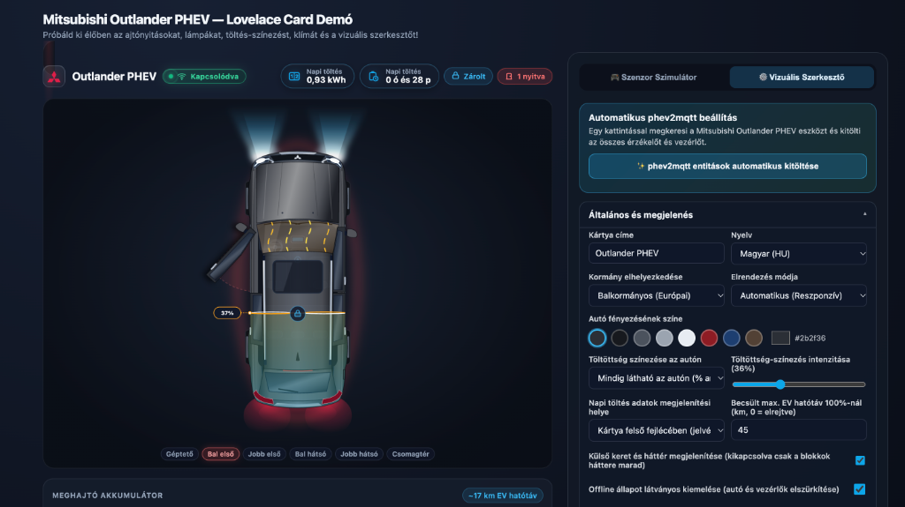
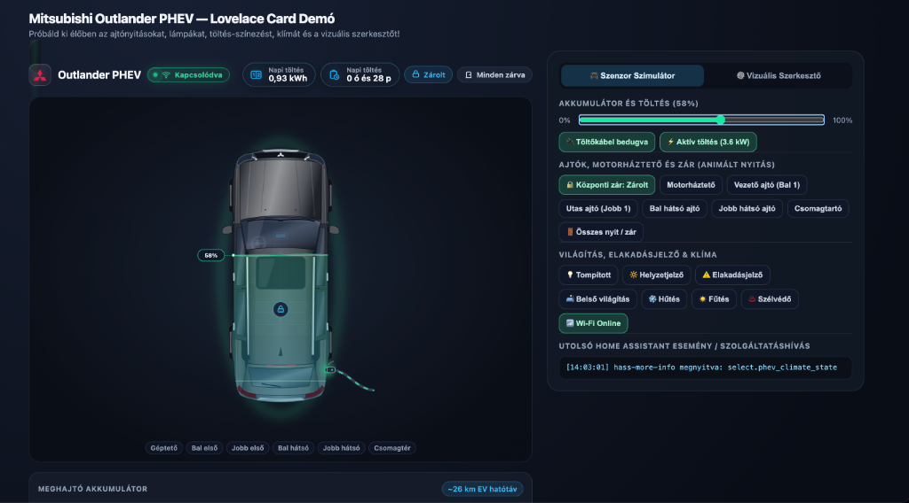
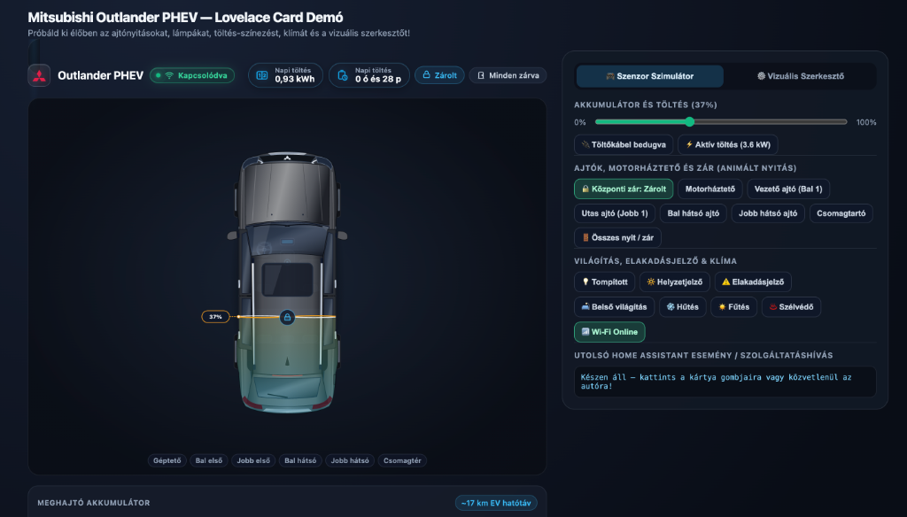
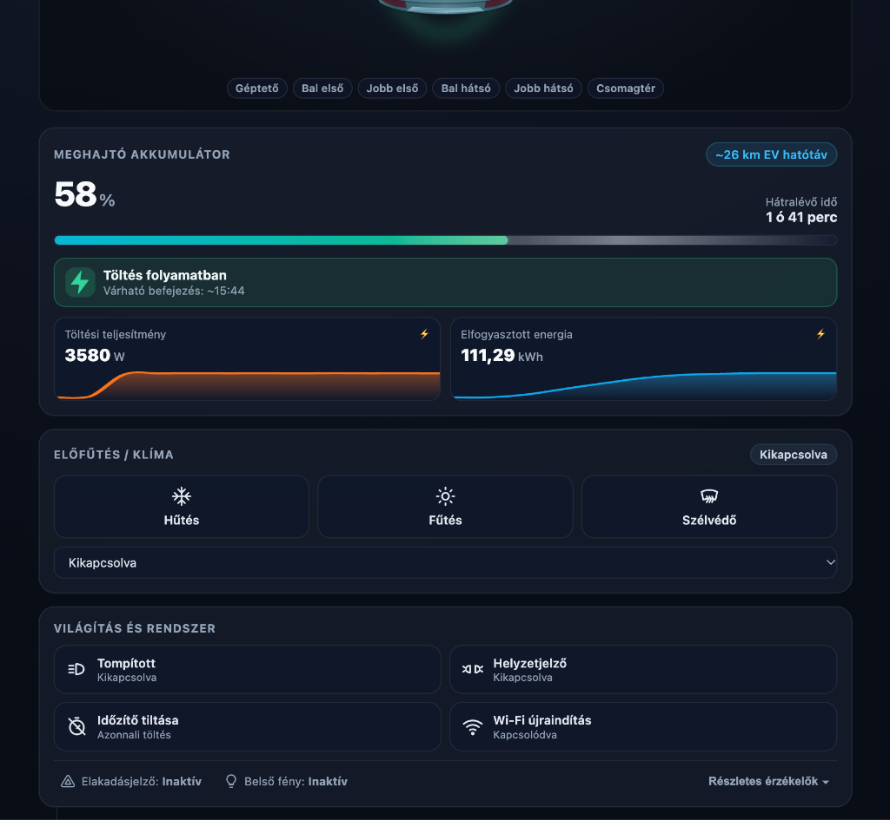

<div align="center">

# 🚗 Mitsubishi Outlander PHEV Lovelace Card (`phev2mqtt`)

**Fotorealisztikus, interaktív felülnézeti Home Assistant Lovelace kártya a Mitsubishi Outlander PHEV (`phev2mqtt`) összes érzékelőjéhez és vezérlőjéhez**

[](./package.json)
[](https://hacs.xyz)
[](https://www.home-assistant.io/)
[](https://rinszky.github.io/ha-lovelace-outlander-card/demo/)

<br />

<a href="./docs/screenshots/hero-lights-doors-editor.png">
  
</a>

*Felkapcsolt tompított fényszóró és hátsó helyzetjelző, nyitott vezetőoldali ajtó biztonsági ívvel, aktív szélvédő-páramentesítés, `37%`-os arányos akkumulátor-színezés és az 1-kattintásos Vizuális Szerkesztő.*

</div>

---

## 📸 Képernyőképek és Állapotok

<table>
  <tr>
    <td width="50%" align="center" valign="top">
      <a href="./docs/screenshots/charging-active.png">
        
      </a>
      <br />
      <b>⚡ Aktív töltés (<code>58%</code>)</b><br />
      <sub>Smaragdzöld energia-aura, nyitott jobb hátsó töltőfedél pulzáló töltőkábellel és valós idejű karosszéria-színezéssel.</sub>
    </td>
    <td width="50%" align="center" valign="top">
      <a href="./docs/screenshots/idle-locked-simulator.png">
        
      </a>
      <br />
      <b>🔒 Zárolt alapállapot &amp; Szenzor Szimulátor</b><br />
      <sub>Letisztult sötét stúdió megjelenés zárolt központi zárral, napi töltés jelvényekkel és az interaktív tesztpanellel.</sub>
    </td>
  </tr>
</table>

<div align="center">
  <a href="./docs/screenshots/telemetry-controls.png">
    
  </a>
  <br />
  <b>📊 Telemetria, 24 órás Sparkline Grafikonok és Vezérlőpanelek</b><br />
  <sub>Hátralévő töltési idő és várható befejezés, külső fali töltő teljesítmény (<code>W</code>) és energia (<code>kWh</code>) grafikonok, egyérintéses klíma-előfűtés/hűtés/szélvédő vezérlés, valamint világítás- és rendszerkapcsolók.</sub>
</div>

---

## ✨ Főbb funkciók

- **Részletgazdag felülnézeti Mitsubishi Outlander PHEV (Dynamic Shield) SVG grafika**
  - Szabadon választható metálfényezés (8 gyári színprofil + egyedi színválasztó, alapértelmezett: sötétszürke/grafitfekete).
  - Balkormányos (LHD) és jobbkormányos (RHD) kivitel támogatása (kormánykerék és vezetőoldali ajtó automatikus tükrözésével).
- **Töltöttség-arányos színezés közvetlenül az autón (`0–100%`)**
  - Az autó karosszériája hátulról előre pontosan olyan százalékban kap dinamikus energiaszínezést és lézeres/hullámzó határvonalat (`%` jelölővel), ahány százalékon áll a meghajtó akkumulátor.
  - Opcionális **PHEV akkupakk röntgennézet** az utastér padlója alatt.
- **Valósághű animációk**
  - **Ajtónyitás**: A 4 oldalajtó (a visszapillantó tükrökkel együtt!), a **motorháztető** (alatta látható MIVEC + PHEV inverter motortérrel) és a **csomagtartó** finom fizikával nyílik, biztonsági figyelmeztető ívvel.
  - **Világítás**: Felkapcsolt **tompított fényszórónál** dupla xenon fénycsóva vetül az autó elé; **helyzetjelzőnél** világítanak az első LED menetfények és a hátsó rubinvörös lámpák; **elakadásjelzőnél** ütemesen villog a 4 sarokindex és a tükörindex; **belső világításnál** meleg fény dereng az utastérben.
  - **Klíma-animáció**: Hűtésnél jeges kék légáramlás, fűtésnél meleg narancs hőáramlás az utastérben, szélvédő-páramentesítésnél pedig hullámzó fűtőszál-effekt a szélvédőn.
  - **Jobb hátsó töltőcsatlakozó**: Csatlakoztatott kábelnél kinyílik a töltőfedél és megjelenik a töltőkábel, aktív töltésnél pedig pulzáló energiaimpulzusok futnak be az autóba.
- **Külső és Napi töltésmérő segéd-entitások támogatása**
  - Opcionálisan beköthető **Napi töltés energiában (`kWh` / `kW`)** és **Napi töltési idő órában (`h` / `perc` / `history_stats`)** segéd-entitás, amely választhatóan a kártya felső fejlécében (jelvényként), a töltési panelen kiemelt kártyaként, vagy mindkét helyen megjeleníthető.
  - Opcionálisan beköthető külső fali töltő / okoskonnektor **Teljesítmény (`W` / `kW`)** és **Elfogyasztott energia (`kWh`)** szenzor 24 órás Home Assistant előzmény-grafikonnal (sparkline).
- **Látványos Kapcsolati / Offline (Alvó) Állapotjelzés**
  - Fejlécben pulzáló telemetria-kapszula (`Kapcsolódva` / `Nincs kapcsolat`).
  - Ha megszakad a Wi-Fi kapcsolat az autóval (`phev2mqtt`), az autó elszürkül és egy üveghatású **Offline HUD kártya** jelenik meg rajta hullámzó radar-animációval, az utolsó elérhetőség idejével és közvetlen **Wi-Fi újracsatlakozás** gombbal; az elérhetetlen autó-vezérlők elhalványulnak, miközben a külső töltő- és napi mérők aktívak maradnak.
- **✨ 1-kattintásos `phev2mqtt` automatikus felismerés és Vizuális Szerkesztő**
  - Nincs szükség kézi YAML írásra: a kártya hozzáadásakor vagy a szerkesztőben lévő gombbal automatikusan megkeresi a Mitsubishi Outlander PHEV eszközt és beállítja az összes entitást.

---

## Telepítés

### A) HACS (Egyéni tárolóként / Custom Repository)
1. Nyisd meg a **HACS** felületet a Home Assistantban.
2. Kattints a jobb felső `⋮` menüre -> **Egyéni tárolók (Custom repositories)**.
3. Add meg a GitHub tároló URL-jét, kategóriának válaszd az **Irányítópult (Dashboard / Lovelace)** típust, majd telepítsd.

### B) Kézi telepítés (1 fájl bemásolásával)
1. Másold a gyökérkönyvtárban található [`outlander-phev-card.js`](./outlander-phev-card.js) fájlt a Home Assistant `/config/www/` mappájába.
2. A Home Assistantban menj ide: **Beállítások -> Irányítópultok -> `⋮` (jobb felül) -> Erőforrások (Resources)**.
3. Kattints az **Erőforrás hozzáadása** gombra:
   - **URL:** `/local/outlander-phev-card.js?v=1.3.0`
   - **Típus:** `JavaScript modul (JavaScript Module)`
4. Frissítsd a böngészőt (`Ctrl+F5` / `Cmd+Shift+R`), majd add hozzá a **Mitsubishi Outlander PHEV Card** kártyát bármelyik irányítópulthoz!

---

## YAML Konfigurációs Példa

> **Tipp:** Ha csak annyit adsz meg, hogy `type: custom:outlander-phev-card`, a kártya automatikusan megpróbálja felismerni a `phev2mqtt` entitásaidat, illetve mindent beállíthatsz a grafikus felületen!

```yaml
type: custom:outlander-phev-card
title: Outlander PHEV
language: hu
steering_side: left
car_color: "#2b2f36"
battery_fill_mode: always      # always | xray | charging | off
battery_fill_opacity: 36       # 15..75 (%)
layout_mode: auto              # auto | wide | compact
daily_charge_position: header  # header | panel | both
max_ev_range: 45               # Becsült max EV hatótáv km-ben (0 = elrejtve)
show_card_frame: true          # false = külső keret/háttér elrejtése, csak a belső blokkok háttere marad
offline_dimming: true          # Autó és elérhetetlen vezérlők elszürkítése offline állapotban
show_sunroof: true
interactive_car: true
confirm_wifi_restart: true

# Akkumulátor és töltés (phev2mqtt + opcionális napi és külső mérők)
battery_entity: sensor.phev_battery
daily_charge_energy_entity: sensor.napi_toltes_kwh
daily_charge_time_entity: sensor.napi_toltes_ido
charging_entity: binary_sensor.phev_charging
charger_connected_entity: binary_sensor.phev_charger_connected
charge_remaining_entity: sensor.phev_charge_remaining
charge_remaining_hrs_entity: sensor.phev_charge_remaining_hrs
estimated_completion_entity: sensor.phev_estimated_charge_completion
disable_charge_timer_entity: switch.phev_disable_charge_timer
charger_power_entity: sensor.tolto_teljesitmeny_w
charger_energy_entity: sensor.tolto_elfogyasztott_kwh

# Ajtók és központi zár
locked_entity: binary_sensor.phev_locked
driver_door_entity: binary_sensor.phev_driver_door
front_passenger_door_entity: binary_sensor.phev_front_passenger_door
rear_left_door_entity: binary_sensor.phev_rear_left_door
rear_right_door_entity: binary_sensor.phev_rear_right_door
bonnet_entity: binary_sensor.phev_bonnet
boot_entity: binary_sensor.phev_boot

# Klíma
climate_state_entity: select.phev_climate_state
cool_entity: switch.phev_cool
heat_entity: switch.phev_heat
windscreen_entity: switch.phev_windscreen

# Világítás és kapcsolat
head_lights_entity: light.phev_head_lights
park_lights_entity: light.phev_park_lights
hazard_lights_entity: binary_sensor.phev_hazard_lights
interior_lights_entity: binary_sensor.phev_interior_lights
connected_entity: binary_sensor.phev_connected
restart_wifi_entity: button.phev_restart_wifi_connetion
```

---

## Helyi Interaktív Demó kipróbálása

A projekt tartalmaz egy önálló böngészős szimulátort a [`./demo/index.html`](https://rinszky.github.io/ha-lovelace-outlander-card/demo/) fájlban, amellyel Home Assistant nélkül is azonnal kipróbálhatod az összes ajtó-, lámpa-, töltés- és klíma-animációt, valamint a vizuális szerkesztőt.

Ha módosítod a `src/` mappában lévő fájlokat, az egyfájlos `outlander-phev-card.js` csomag újraépítéséhez futtasd:

```bash
npm run build
```
