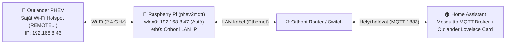

# 📡 Részletes útmutató: `phev2mqtt` telepítése Raspberry Pi-re és összekötése a Home Assistanttal

Ez az útmutató lépésről lépésre bemutatja, hogyan tudod a **Mitsubishi Outlander PHEV** autódat helyi hálózaton (felhő nélkül, az autó gyári Wi-Fi vezérlésén keresztül) bekötni a **Home Assistant** alá a [**buxtronix/phev2mqtt**](https://github.com/buxtronix/phev2mqtt) átjáróval, hogy a **Mitsubishi Outlander PHEV Lovelace Card** minden érzékelőt és vezérlőt megjeleníthessen.

---

## 🏗️ Hogyan épül fel a rendszer?

A Mitsubishi Outlander PHEV nem az otthoni Wi-Fi hálózatra csatlakozik fel, hanem **saját, zárt 2.4 GHz-es Wi-Fi hotspotot** sugároz (`REMOTE...` nevű SSID, internetkapcsolat nélkül, `192.168.8.46` belső IP-címmel).

Emiatt egy kis fogyasztású „híd” eszközre — legideálisabb esetben egy **Raspberry Pi**-re — van szükség a garázsban vagy a kocsibeálló Wi-Fi hatótávolságán belül:



- **Ethernet kábel (`eth0`):** A Raspberry Pi kábelen csatlakozik az otthoni routerhez/switchhez — ezen keresztül éri el a Home Assistant MQTT brókerét és az internetet (frissítésekhez, SSH-hoz).
- **Beépített Wi-Fi (`wlan0`):** A Raspberry Pi Wi-Fi kártyája kizárólag az autó `REMOTE...` hotspotjára csatlakozik automatikusan, amint az autó hazaérkezik és hatótávba kerül.

> [!TIP]
> **Mi van, ha nincs LAN kábel a garázsban?** Használhatsz egy plusz USB-s Wi-Fi adaptert is a Raspberry Pi-ben: az alaplapi `wlan0` csatlakozik az autóra, az USB-s `wlan1` pedig az otthoni Wi-Fi-re. A kábeles Ethernet azonban a legstabilabb megoldás.

---

## 📋 Mire lesz szükséged?

1. **Mitsubishi Outlander PHEV** gyári Wi-Fi távvezérléssel (*PHEV Remote*), valamint az autóhoz kapott **SSID (`REMOTE...`) és Wi-Fi jelszó** kártyával.
2. **Raspberry Pi** beépített Wi-Fi-vel és Ethernet porttal:
   - Ideális modellek: **Raspberry Pi 3B / 3B+ / 4 / 5** *(vagy Raspberry Pi Zero 2 W + USB-Ethernet adapter)*.
   - Telepített **Raspberry Pi OS Lite (64-bit vagy 32-bit)** rendszerrel, SSH eléréssel.
3. **Home Assistant** működő **MQTT brókerrel** (pl. *Mosquitto broker* kiegészítő).

---

## 1. lépés: MQTT előkészítése a Home Assistantban

Ha még nincs MQTT brókered a Home Assistantban:

1. Nyisd meg: **Beállítások -> Kiegészítők (Add-ons) -> Kiegészítők boltja**, keresd meg a **Mosquitto broker** kiegészítőt, telepítsd és indítsd el.
2. Hozz létre egy dedikált Home Assistant felhasználót az MQTT-hez: **Beállítások -> Személyek -> Felhasználók fül -> Felhasználó hozzáadása** (pl. név: `mqtt-user`, jelszó megadása, *Csak helyi belépés* engedélyezhető).
3. Menj ide: **Beállítások -> Eszközök és szolgáltatások**, és ellenőrizd, hogy az **MQTT** integráció konfigurálva van-e.
4. Jegyezd fel a Home Assistant belső IP-címét (pl. `192.168.1.50`), az MQTT felhasználónevet és jelszót.

---

## 2. lépés: A Raspberry Pi hálózatának beállítása (LAN + Autó Wi-Fi)

Lépj be SSH-n a Raspberry Pi-re (miközben már **LAN kábelen** csatlakozik a routerhez).

> [!IMPORTANT]
> **Két kritikus dolog, amire figyelni kell:**
> 1. **Útválasztás (Default Gateway):** Az autó DHCP szervere átjáróként hirdeti magát (`192.168.8.46`), pedig nincs rajta internet! Be kell állítani, hogy a Wi-Fi **soha ne legyen alapértelmezett átjáró**, így minden egyéb forgalom a kábeles `eth0` kapcsolaton megy.
> 2. **Fix MAC-cím:** Az autó a Wi-Fi kártya fizikai **MAC-címe** alapján azonosítja a regisztrált eszközt. Ki kell kapcsolni a véletlenszerű MAC-cím generálást (`cloned-mac-address: permanent`).

### A) Modern Raspberry Pi OS (Bookworm vagy újabb — `NetworkManager` / `nmcli`)

Az újabb Raspberry Pi OS rendszerek már `NetworkManager`-t használnak. Állítsd be az autó Wi-Fi kapcsolatát az alábbi parancsokkal *(cseréld ki a `REMOTE45bhds` és `AUTOD_WIFI_JELSZAVA` értékeket a sajátodra)*:

```bash
# 1. Wi-Fi feloldása és energiatakarékos alvó mód kikapcsolása
sudo rfkill unblock wifi

# 2. Dedikált Wi-Fi profil létrehozása az autóhoz (rejtett SSID támogatással, fix MAC-címmel, alapértelmezett átjáró tiltásával)
sudo nmcli connection add type wifi con-name "outlander-phev" ifname wlan0 ssid "REMOTE45bhds" \
  wifi-sec.key-mgmt wpa-psk \
  wifi-sec.psk "AUTOD_WIFI_JELSZAVA" \
  802-11-wireless.hidden yes \
  802-11-wireless.cloned-mac-address permanent \
  802-11-wireless.powersave 2 \
  connection.autoconnect yes \
  connection.autoconnect-retries 0 \
  ipv4.method auto \
  ipv4.never-default yes \
  ipv4.route-metric 600 \
  ipv6.method ignore

# 3. Kapcsolódás elindítása
sudo nmcli connection up "outlander-phev"
```

### B) Régebbi Raspberry Pi OS (Bullseye vagy korábbi — `wpa_supplicant` + `dhcpcd`)

Ha a rendszered még nem `nmcli`-t használ:

1. Szerkeszd a `/etc/wpa_supplicant/wpa_supplicant.conf` fájlt:
   ```ini
   ctrl_interface=DIR=/var/run/wpa_supplicant GROUP=netdev
   update_config=1
   country=HU

   network={
       ssid="REMOTE45bhds"
       scan_ssid=1
       psk="AUTOD_WIFI_JELSZAVA"
   }
   ```
2. A `/etc/dhcpcd.conf` végére írd be, hogy a `wlan0` ne vegye át az internet-átjárót a LAN kábeltől:
   ```ini
   interface wlan0
   nogateway
   metric 600
   ```
3. Indítsd újra a hálózatot vagy a Pi-t (`sudo reboot`).

### Kapcsolat ellenőrzése

Amikor az autó a közelben van (és nem alszik mélyen — pl. nyisd ki/zárd be az ajtót), ellenőrizd az IP-címet:

```bash
ip addr show wlan0
```

Ha sikeres a csatlakozás, a `wlan0` interfészen a **`192.168.8.47`** IP-címet fogod látni, miközben a `ping -c 3 8.8.8.8` továbbra is működik az `eth0` kábelen keresztül!

---

## 3. lépés: A `phev2mqtt` letöltése és lefordítása

A [`buxtronix/phev2mqtt`](https://github.com/buxtronix/phev2mqtt) Go nyelven íródott, és közvetlenül a Raspberry Pi-n pár másodperc alatt lefordítható.

### 1. Szükséges csomagok és friss Go fordító telepítése

Nézd meg a Raspberry Pi architektúráját az `uname -m` paranccsal:
- **`aarch64`** (64 bites Raspberry Pi OS — RPi 3/4/5/Zero 2 W): a `linux-arm64` csomag kell.
- **`armv7l` / `armv6l`** (32 bites OS): a `linux-armv6l` csomag kell.

Példa **64 bites (`aarch64`)** rendszerre:

```bash
sudo apt update && sudo apt install -y git wget tar

# Legújabb Go letöltése és kicsomagolása (64-bit ARM64 esetén; 32-bithez: go1.22.5.linux-armv6l.tar.gz)
wget https://go.dev/dl/go1.22.5.linux-arm64.tar.gz
sudo rm -rf /usr/local/go && sudo tar -C /usr/local -xzf go1.22.5.linux-arm64.tar.gz
rm go1.22.5.linux-arm64.tar.gz

export PATH=$PATH:/usr/local/go/bin
go version
```

### 2. A `phev2mqtt` klónozása és fordítása

```bash
cd ~
git clone https://github.com/buxtronix/phev2mqtt.git
cd phev2mqtt
/usr/local/go/bin/go build

# Bináris bemásolása a rendszerútvonalra
sudo cp phev2mqtt /usr/local/bin/phev2mqtt
sudo chmod +x /usr/local/bin/phev2mqtt

# Ellenőrzés
phev2mqtt -h
```

---

## 4. lépés: A Raspberry Pi párosítása (regisztrálása) az autóval

Az Outlander PHEV legfeljebb **2 Wi-Fi eszközt** enged regisztrálni (pl. 1 telefon + 1 Raspberry Pi).

> [!WARNING]
> **Fontos a regisztráció előtt:** Kapcsold ki ideiglenesen a Wi-Fi-t a telefonodon (hogy a gyári Mitsubishi telefonos app ne csatlakozzon rá az autóra párosítás közben)!

### 1. Tedd az autót regisztrációs módba (Mitsubishi gyári eljárás)
1. Ülj be az autóba a kulccsal, csukd be az összes ajtót.
2. **Ne lépj a fékpedálra**, és nyomd meg egyszer a **POWER (Start)** gombot (**ACC** módba kerül az autó).
3. A távirányító kulcson **10 másodpercen belül** nyomd meg felváltva a **Zárás (Lock)** és **Nyitás (Unlock)** gombokat összesen **10-szer** (Zár – Nyit – Zár – Nyit – Zár – Nyit – Zár – Nyit – Zár – Nyit).
4. Az autó sípolással jelzi, hogy belépett a regisztrációs módba (és a műszerfalon mutatja a jelenleg párosított eszközök számát).

> [!NOTE]
> **Ha már be van telve mind a 2 eszközhely:** Ugyanezzel a módszerrel (ACC módban) nyomd meg felváltva **20-szor** (10 pár) a Zárás / Nyitás gombot az összes korábbi párosítás törléséhez, majd ismételd meg a 10 gombnyomást a regisztrációs módhoz!

### 2. Futtasd a regisztrációt a Raspberry Pi-n
Amíg az autó regisztrációs módban van (erre kb. pár perced van), ellenőrizd, hogy a `wlan0` megkapta-e a `192.168.8.47` IP-t, majd futtasd:

```bash
phev2mqtt client register
```

Néhány másodpercen belül megjelenik a sikeres regisztrációt jelző üzenet!

### 3. Kommunikáció tesztelése
Teszteld, hogy jönnek-e élőben az adatok az autóból:

```bash
phev2mqtt client watch
```

Látni fogod a folyamatosan érkező töltöttségi, ajtó- és klímaüzeneteket. Lépj ki `Ctrl+C`-vel.

---

## 5. lépés: Összekötés a Home Assistanttal és automatikus indítás (`systemd`)

A `phev2mqtt` beépítve tartalmazza a **Home Assistant MQTT Auto-Discovery** funkciót, így egyetlen sor YAML szenzor-definícióra sincs szükség!

### 1. Első kézi próba az MQTT brókerrel

Futtasd az alábbi parancsot a saját Home Assistant IP-címeddel és MQTT adataiddal:

```bash
/usr/local/bin/phev2mqtt --config=/dev/null client mqtt \
  --mqtt_server tcp://192.168.1.50:1883/ \
  --mqtt_username mqtt-user \
  --mqtt_password TITKOS_JELSZO \
  -v=info
```

Állítsd le pár másodperc után `Ctrl+C`-vel, majd hozz létre belőle háttérszolgáltatást, hogy újraindítás után is mindig magától fusson.

### 2. Automatikus indítás beállítása (`systemd` service)

Hozd létre a `/etc/systemd/system/phev2mqtt.service` fájlt:

```bash
sudo nano /etc/systemd/system/phev2mqtt.service
```

Illeszd be az alábbi tartalmat *(írd át az IP-címet, felhasználónevet és jelszót)*:

```ini
[Unit]
Description=Mitsubishi Outlander PHEV to MQTT Gateway (phev2mqtt)
After=syslog.target network-online.target
Wants=network-online.target
StartLimitIntervalSec=5

[Service]
Type=exec
ExecStart=/usr/local/bin/phev2mqtt --config=/dev/null client mqtt --mqtt_server tcp://192.168.1.50:1883/ --mqtt_username mqtt-user --mqtt_password TITKOS_JELSZO -v=info
Restart=always
RestartSec=30s
SyslogIdentifier=phev2mqtt
StandardOutput=journal
StandardError=journal

[Install]
WantedBy=multi-user.target
```

Engedélyezd és indítsd el a szolgáltatást:

```bash
sudo systemctl daemon-reload
sudo systemctl enable phev2mqtt.service
sudo systemctl start phev2mqtt.service
```

> [!TIP]
> **Home Assistant Discovery tipp:** Az első MQTT Discovery üzenetek kiküldése után érdemes egyszer újraindítani a szolgáltatást (`sudo systemctl restart phev2mqtt.service`), hogy az összes entitás állapota azonnal frissüljön a Home Assistantban!

A naplót bármikor élőben követheted ezzel a paranccsal:

```bash
sudo journalctl -f -u phev2mqtt -o cat
```

---

## 6. lépés: Ellenőrzés a Home Assistantban és Kártya Hozzáadása

1. Nyisd meg a Home Assistantban: **Beállítások -> Eszközök és szolgáltatások -> MQTT**.
2. Meg fog jelenni az új **PHEV** eszköz az összes érzékelővel és kapcsolóval (`sensor.phev_battery`, `binary_sensor.phev_driver_door`, `switch.phev_heat`, `light.phev_head_lights`, `binary_sensor.phev_connected`, stb.).
3. Add hozzá az irányítópultodhoz a **Mitsubishi Outlander PHEV Card** kártyát (lásd a [fő README telepítési leírását](../README.md#-telepítés-lovelace-kártya)).
4. A kártya grafikus szerkesztőjében kattints a **„✨ phev2mqtt entitások automatikus kitöltése”** gombra — a kártya automatikusan megtalálja és összerendeli az összes létrehozott entitást!

---

## 🛠️ Gyakori kérdések és hibaelhárítás

- **Mikor alszik el az autó Wi-Fi modulja (`Nincs kapcsolat` állapot)?**
  - Ha az autó nincs töltőn és hosszabb ideig áll lezárva, az Outlander a 12V-os segédakkumulátor kímélése érdekében időszakosan lekapcsolhatja a Wi-Fi modult, vagy távol kerül a garázstól, amikor elhajtasz vele. Ilyenkor a kártya automatikusan **Offline (Alvó)** nézetre vált, és jelzi az utolsó elérhetőség idejét. Amint kinyitod az autót, töltőre dugod, vagy hazaérsz vele, a Raspberry Pi másodperceken belül automatikusan visszacsatlakozik!
- **A telefonos gyári appot is használhatom mellette?**
  - Az autó Wi-Fi modulja **egyszerre csak egyetlen aktív TCP klienst** szolgál ki. Amíg a Raspberry Pi csatlakozva van, minden vezérlést (előfűtés, hűtés, lámpák, töltésidőzítő tiltása) távolról, bárhonnan a világból sokkal gyorsabban és megbízhatóbban érsz el a **Home Assistant mobilalkalmazáson** keresztül, mint a gyári közelre ható Wi-Fi appal!
- **Nem kap `192.168.8.47` IP-t a Raspberry Pi:**
  - Ellenőrizd az `rfkill list` paranccsal, hogy nincs-e szoftveresen tiltva a Wi-Fi (ha igen, állítsd be az országkódot a `sudo raspi-config` -> *Localisation Options -> WLAN Country* menüben), valamint győződj meg róla, hogy az autó elég közel áll a Raspberry Pi-hez (2.4 GHz-es vétel).
